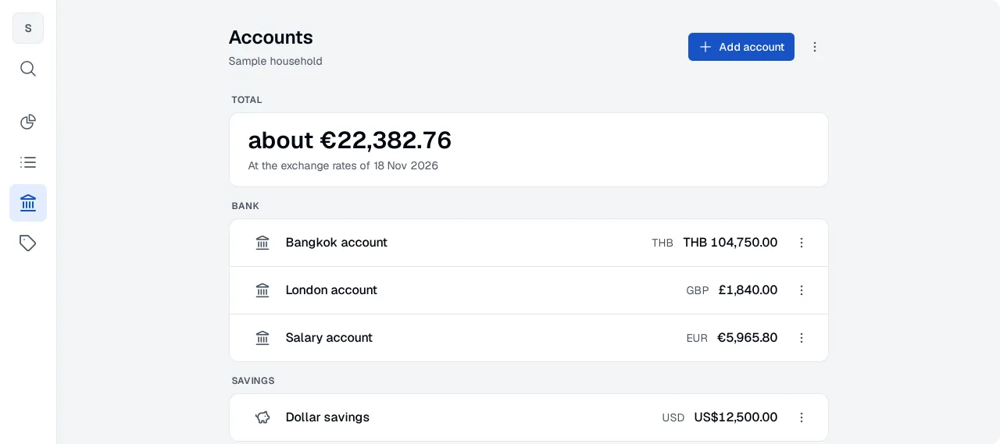
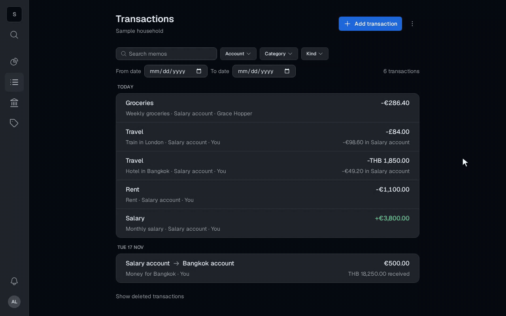

# Financy

**A free, open-source finance tracker for a person or a family, in any mix of currencies.**

[Website](https://financy.dev) · [Live demo](https://demo.financy.dev) ·
[Self-host](docs/financy/self-host.md)

<picture>
  <source media="(prefers-color-scheme: dark)" srcset="docs/screenshots/accounts-dark-1280.webp">
  
</picture>

**Status: works today, before its launch release.** You can run it on your own server now, or
try the [live demo](https://demo.financy.dev). Sign-up on financy.dev is by invitation until the
paid cloud opens. Pre-launch versions can still change how things look and work; the
[launch milestone](https://github.com/spy4x/financy/milestones) shows what is left.

## What it does

- **Every currency, one total.** Accounts in any currency, crypto included. Every transaction
  keeps its original amount next to the converted one, so a later exchange rate never rewrites
  your history.
- **Made for households.** Share accounts and budgets with your partner or family, each with
  their own role, and see every change live on every device.
- **Budgets, transfers and repeating payments**, spreadsheet export, and a Telegram bot to add
  an expense on the go and ask for your balances.
- **Works offline.** The app keeps your data on the device and syncs when you are back online.
- **Yours to host, or ours.** Free and open source to run on your own server, with a paid cloud
  for people who would rather not.

  

## Compared with Actual Budget and Firefly III

Stay on Actual Budget for envelope budgeting, automatic bank sync or an app that runs without a
server. Stay on Firefly III for double-entry bookkeeping or if you track money alone. Choose
Financy when your household's money sits in several currencies and you want one total, with
each person signing in with their own login. The website compares them in detail: [Actual Budget](https://financy.dev/alternatives/actual-budget),
[Firefly III](https://financy.dev/alternatives/firefly-iii) and
[the others](https://financy.dev/alternatives).

## Quick start

Run Financy for your household on your own server with Docker Compose: follow
[docs/financy/self-host.md](docs/financy/self-host.md), also at
[financy.dev/docs/self-host](https://financy.dev/docs/self-host). A fresh install takes about 15
minutes.

Financy is built on [Seed](https://github.com/spy4x/seed), the free SaaS starter, with Hono and
Preact on web standards, so the same code runs on Deno, Node.js and Bun. To develop it,
[docs/development.md](docs/development.md) has the commands; how it keeps taking Seed's changes is
in [AGENTS.md](AGENTS.md).

## The first Financy

The first version lives on the [`legacy`](https://github.com/spy4x/financy/tree/legacy) branch.
It is frozen: it shows what Financy did, and nothing more is built on it.

## Licence

Financy is licensed under the [GNU AGPL-3.0](LICENSE). It is built on Seed, whose code keeps its
MIT notice in [LICENSES/MIT-seed.txt](LICENSES/MIT-seed.txt).

---

Made by Anton Shubin · [antonshubin.com/tools](https://antonshubin.com/tools)
